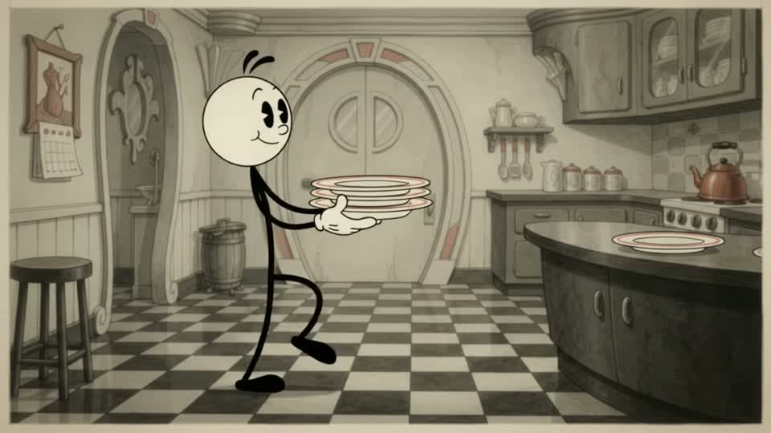

# A7 · 橡皮管动画风 · Rubber Hose Animation

This is an **A · Model Engine（模型引擎） video-model style**. Follow the [A unified workflow](mode-execution-boundaries.md#a-unified-workflow) for storyboard confirmation, prompt handoff, optional low-cost trial and final-production authorization; the drawing, reference and acting rules below remain A7-specific. Read [frozen prompts](a7-prompt-contract.md), [acceptance](a7-acceptance.md) and the [reference manifest](../assets/a7/reference-manifest.json). Use the shared [A production and review contract](a-production-and-review.md) for source-to-edit timing, progress records, scoped retries and actual-output review. A7 retains its own story structure, acting and finishing: do not import A1–A5's five-stage structure, mandatory voice profiles or no-post-text contract, A6 lighting/narration, or a B-style code renderer.

For independent continuous music, optional narration/dialogue, action-mapped effects, ambience and actual final-file listening, apply the [A audio timeline contract](a-audio-timeline-and-review.md). It does not change the frozen character/drawing blocks, accepted samples or A7's no-default-narration/lyrics choices.

## The approved visual grammar

An original thin-line stickman performs elastic theatrical comedy inside finely drawn early-cartoon scenery. A neutral paper-white circular face, two fine curved hair tufts, black oval eyes, tiny brows and mouth establish identity. The head touches a short neck; neck, spine and limbs stay individual narrow ink strokes, with connected small hands and short black curved feet. No yellow face, thick hair clumps, filled/triangular chest, thick torso, costume or bow tie. Do not substitute a familiar copyrighted cartoon character.

Period scenery uses confident visible pen contours, architectural craftsmanship, hinges, seams and restrained painted texture. Dusty sage-gray, pearl gray, gray-taupe and pale ivory carry the scene, with tiny faded brick-red accents. This is subdued **color**, not pure monochrome or a sepia wash. Richness comes from drawing, not clutter, heavy scratches or smooth 3D materials. Even diffuse illumination keeps the face white; avoid bloom, dramatic light pools, glossy bevels and CGI shading. New settings retain this drawing method as well as the palette, with quiet action space around the actor.

## Successful default: reference material directly to video

Use the successful MV workflow: **reuse the approved character/style text and an existing kitchen drawing reference, write a compact new scene and timed action, then generate video directly**. The post-office and seaside-pier tests used this route and were explicitly accepted by the user. Their exact expanded prompts and evidence limits are [bundled](../assets/a7/validated-workflow.json).

There is no mandatory new still, still-approval round or 360p/5s probe for every location. The accepted new-location tests used Flow Omni1.2 Flash, **720p · 10 seconds · native 16:9 · one result per scene**. These are observed settings, not a permanent provider guarantee or a universal A7 duration. Follow the user's chosen model, settings and existing spend authorization. After the approved storyboard and independent prompts, offer one optional cost-saving trial using representative action and the chosen model’s lowest available output resolution, within authorized spend. This is an initial preview stage, not a new still, reference-approval round or test for every location. Reuse an accepted trial or explicit final-production authorization. Additional stills or probes are diagnostics for a specific failure, not automatic paid stages.

## Bundled references and actual model inputs

| Primary drawing reference | Additional location comparisons |
|---|---|
|  | [Courtyard](../assets/a7/courtyard.jpg) · [Attic](../assets/a7/attic.jpg) |

Inspect the primary image and attach it to the model's supported **material/reference-image input for identity and drawing style**, not its literal first-frame slot. In the successful Flow tests, this was video type **素材**, using the already saved kitchen frame from “02 橡皮管喜剧 · 720p精修”. Verify the attached thumbnail and output settings before submitting. Merely naming the image or viewing it locally does not condition the model. Additional images are optional; do not attach every comparison mechanically.

For a fresh installation, use the bundled `kitchen.jpg` as the portable starting reference. It is a clean frame extracted from the approved MV kitchen take. The saved Flow input used in the two tests is a separate existing image: its original bytes were not downloaded, so the bundled file is **not claimed to be byte-identical or itself newly tested in those jobs**. Where that already approved provider asset is available, reuse it. Otherwise use the bundled reference and judge the new output under the same acceptance gates.

Record the actual input file/hash when available, or the provider asset identity and verified thumbnail when the original bytes are unavailable; also record input slot, role, exact prompt and job ID. Do not invent an image hash or download against the user's instruction just to fill it. The manifest keeps bundled-file fingerprints separate from provider-input provenance.

The kitchen anchors the drawing, not the opening shot, layout or props of a new story. Start in the requested new location. If the selected tool supports only first-frame conditioning, resolve that limitation within the user's scope before submitting; an optional new-scene still requires the appropriate generation authorization. Do not silently switch models, add uploads, download, spend or call a text-only diagnostic the tested material-reference workflow.

## Model Engine production and repair

1. Reuse the brief, approved identity, ratio and audio choices. Show a concise story/beat plan for confirmation, then deliver the complete independent prompts, reference files/input roles and intended settings. Offer optional generation through the built-in browser, defaulting to Flow. When the user has already approved the plan or explicitly asked to execute a test, continue within that scope without another approval round; prompt-only delivery alone does not authorize generation. Narration, lyrics, a specific song, sadness, cloud companions and sample plots are not A7 defaults.
2. Build each standalone prompt from the four blocks: **fixed character → fixed drawing/palette → variable scene → timed action/camera**. Copy Blocks 1 and 2 verbatim. Block 3 briefly identifies the period setting, a few inked/painted construction details, essential props and clear acting space. Block 4 supplies readable setup, action, consequence and reaction. Use the [accepted examples](a7-prompt-contract.md#accepted-expanded-examples); no extra compulsory anchor paragraph or decorative inventory. Check that the variable blocks do not contradict the fixed drawing rules.
3. For an authorized initial trial, verify the reference material, model, ratio, duration, lowest currently available resolution, result count and credit quote; generate only the representative scope and show the actual result for user review. Once its effect is accepted, confirm the final resolution, maximum total credit budget including retries, any paid non-credit services and final-video scope before generating the remaining film. A trial does not authorize the whole film, and low-resolution acceptance does not certify fine detail at the final resolution. Reuse existing equivalent approvals. Save the exact submitted prompt and returned job ID. Reuse accepted results; check existing jobs after interruption instead of resubmitting blindly.
4. Direct anticipation, connected elastic movement, impact/overshoot, recovery, blinks and facial reactions. Keep grip/release, weight and planted steps readable, with shoulder/hip counter-motion. A sliding body, random flailing or detached limbs is not rich acting. The spine remains a thin line through bends and stretches.
5. Use motivated framing, cuts and camera moves for setup, contact, reveal, reaction and payoff, maintaining screen direction and prop states. Do not impose a fixed shot count: actions must remain readable. For music-led work, analyze the authorized segment and align meaningful actions/cuts with its accents and phrase changes. A long static pose, random zoom or unrelated set change does not supply rhythm.
6. Review the actual video against [all applicable gates](a7-acceptance.md). If the background drifts, repair only scene details/reference conditioning; if anatomy fails, simplify the offending pose/contact; if rhythm is weak, revise the timed performance and motivated framing. Preserve the fixed blocks and accepted shots/audio. A targeted cheaper probe or still may diagnose a persistent defect; it is not a recurring default stage. Recheck the changed result rather than equating a corrected prompt with a corrected film.
7. Finish locally only when authorized. Preserve accepted audio and assemble an independent continuous music master or deliberate cues, optional full narration, action-mapped Foley and ambience. For an MV, the approved song/excerpt is the master clock; do not restart or regenerate it per source clip. Avoid doubled native music; a flattened clip mix cannot be assumed to separate cleanly. Track cue mappings, source fingerprints, licenses and required attribution; the showcase song is not automatically reusable. Actually watch/listen to the complete final encoded mix at normal speed, including joins and ending tails; meters alone are insufficient and absent listening capability is `not_checked`. Lyrics are **optional for the particular showcase**, not a standard A7 requirement.
8. Default generated footage has no incidental captions, words, logos or watermark. When text is requested, add readable period-compatible typography during finishing, timed by meaning and actual phrase pauses in any language. Preserve phrases, safe areas, contrast and readable duration; use purposeful emphasis/micro-animation without hiding the actor. A future portrait film needs native staging and separate review, not a crop or inherited landscape pass.

## Evidence and delivery scope

The two new-location tests establish a user-accepted workflow example, not guaranteed stability for every future scene. The assistant's review was partial and then stopped at the user's request; no full playback or final-audio audit is inferred. Future finished films still require actual-output review, with technical checks, creative review and user approval recorded separately.

Keep the approved README pair: A7.1 “乌云追逐” (10 seconds) and A7.2 “雨中街头” (8 seconds after its first 2 seconds were removed), both 1920×1080. The top preview remains A7.1. New test prompts do not replace these showcases or add gallery clips. The earlier 《烂奇迹》 MV stays in the local archive; its song, lyrics and plot do not become defaults.

Deliver each authorized new film with its local preview, containing-folder shortcut, actual review status and material limitations. Selecting A7 alone does not authorize external publication or new paid operations. Save prompts, job IDs, actual references, edits and output fingerprints in the project checkpoint. Never call a technical pass proof of matched appearance, motion or sound.
